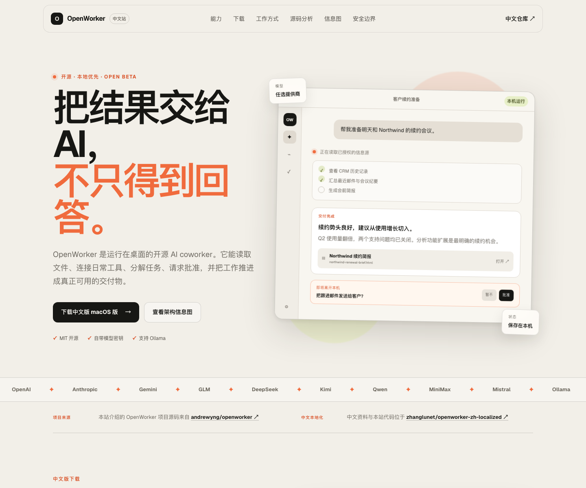

# OpenWorker — Fully Localized Chinese Edition (Chinese GUI + macOS Desktop Client)

<p align="center"><a href="./README.md">中文</a> | <a href="./README.en.md">English</a></p>

<p align="center"><strong>An English AI desktop assistant, opened the Chinese way.</strong></p>

<p align="center"><sub>8 UI module groups fully localized · 2 layers (web GUI + desktop shell) · 3 ways to run · 1 DMG, ready to use</sub></p>

> This repository: **https://github.com/zhanglunet/openworker-zh-localized**
>
> A second-pass reorganization based on [Lenovo202409/openworker-zh](https://github.com/Lenovo202409/openworker-zh), feature-identical with upstream [andrewyng/openworker](https://github.com/andrewyng/openworker) — only the interface has been localized into Chinese.
>
> Follows the original project's MIT license; for learning and personal local use only.

<a href="https://trendshift.io/repositories/91434?utm_source=trendshift-badge&amp;utm_medium=badge&amp;utm_campaign=badge-trendshift-91434" target="_blank" rel="noopener noreferrer"></a>

> **Beta** - OpenWorker is still in open beta: features are usable, automatic updates keep arriving, and upstream is still rapidly polishing the experience.

## Downloads & the Chinese Intro Site

- Chinese intro site: [https://oaosf.cn](https://oaosf.cn)
- macOS Apple Silicon DMG: [OpenWorker-CN-0.1.7-aarch64.dmg](https://github.com/zhanglunet/openworker-zh-localized/raw/main/releases/OpenWorker-CN-0.1.7-aarch64.dmg)
- GitHub Release: [v0.1.7-zh](https://github.com/zhanglunet/openworker-zh-localized/releases/tag/v0.1.7-zh)
- Website source: [website/](website/)
- In-depth source analysis: [https://oaosf.cn/source-analysis](https://oaosf.cn/source-analysis) (also kept in sync in this repo under [docs/analysis/](docs/analysis/))
- Changelog and weekly reports: [https://oaosf.cn/updates](https://oaosf.cn/updates) (also kept in sync in this repo under [docs/updates/](docs/updates/))
- Full preparation documents for an enterprise-customized edition (PRD, development plan, three-repo sync, deployment, reskin & packaging): [docs/enterprise/](docs/enterprise/)
- Official signing, notarization and auto-update release guide: [docs/release-signed-updates.md](docs/release-signed-updates.md)
- Record of the deferred signing-materials application: [docs/release-signing-deferred-plan.md](docs/release-signing-deferred-plan.md)
- Upstream project source: [andrewyng/openworker](https://github.com/andrewyng/openworker)

The Chinese intro site brings together the product's capabilities, workflows, models and connectors, source-code architecture analysis, security boundaries, interactive infographics, the auto-update changelog, and weekly reports. The site clearly credits the upstream project and links back to this repository.



> The currently public DMG is a non-notarized localized build. The official signing, notarization, and Tauri auto-update release pipeline is already documented: once Apple Developer credentials and Tauri updater Secrets are configured, official packages can be produced via GitHub Actions.
>
> DMG SHA-256: `0ee522258294655556ce3e0cd04917386f6bdec34c2a5584debd8b84d22be50a`

---

## Table of Contents

- [OpenWorker — Fully Localized Chinese Edition (Chinese GUI + macOS Desktop Client)](#openworker--fully-localized-chinese-edition-chinese-gui--macos-desktop-client)
  - [Downloads & the Chinese Intro Site](#downloads--the-chinese-intro-site)
  - [Table of Contents](#table-of-contents)
  - [1. Why Make a Chinese Edition](#1-why-make-a-chinese-edition)
  - [2. Main Differences from the Original](#2-main-differences-from-the-original)
  - [3. Supported Ways to Run](#3-supported-ways-to-run)
  - [4. Quick Start (Recommended)](#4-quick-start-recommended)
    - [4.1 Download the macOS Chinese Edition Directly](#41-download-the-macos-chinese-edition-directly)
    - [4.2 Run from Source](#42-run-from-source)
    - [4.3 One-Command Launch (Environment Already Installed)](#43-one-command-launch-environment-already-installed)
  - [5. First-Time Environment Setup](#5-first-time-environment-setup)
    - [5.1 A No-sudo Approach for macOS Users](#51-a-no-sudo-approach-for-macos-users)
    - [5.2 Install Python Dependencies](#52-install-python-dependencies)
    - [5.3 Install Frontend Dependencies](#53-install-frontend-dependencies)
    - [5.4 Install the Rust Toolchain (Required for the Desktop Client)](#54-install-the-rust-toolchain-required-for-the-desktop-client)
  - [6. How to Use](#6-how-to-use)
    - [6.1 Option 1: Access the GUI in a Browser](#61-option-1-access-the-gui-in-a-browser)
    - [6.2 Option 2: Run the Tauri Desktop Client (Development Mode)](#62-option-2-run-the-tauri-desktop-client-development-mode)
  - [7. FAQ](#7-faq)
    - [7.1 Page Won't Open / Blank Screen in the Browser](#71-page-wont-open--blank-screen-in-the-browser)
    - [7.2 Tauri Build Error: Missing CMake](#72-tauri-build-error-missing-cmake)
    - [7.3 Tauri Build Error: Missing Sidecar](#73-tauri-build-error-missing-sidecar)
  - [8. What Has Been Localized](#8-what-has-been-localized)
    - [8.1 Web GUI](#81-web-gui)
    - [8.2 Tauri Desktop Shell](#82-tauri-desktop-shell)
  - [9. Repository Structure](#9-repository-structure)
  - [10. Known Issues and Future Plans](#10-known-issues-and-future-plans)
  - [10.1 Official Signing, Notarization, and Auto-Update](#101-official-signing-notarization-and-auto-update)
  - [11. Contributing and License](#11-contributing-and-license)

---

## 1. Why Make a Chinese Edition

The official [OpenWorker](https://openworker.com) is a powerful open-source local AI Agent desktop application, but its default interface is entirely in English. For users who work in Chinese every day, the localized version is much easier to pick up.

Highlights of this localized edition:

- **Full feature parity with the original project**: only the interface strings are translated; no underlying logic is changed.
- **The desktop app is localized too**: not just the web pages in the browser — the Tauri desktop shell's tray menu, permission prompts, voice-input errors, and more are localized as well.
- **No installer needed**: prepared specifically for users who want to run it directly from source.
- **No sudo for setup**: every toolchain can be installed inside your user directory without polluting the system environment.

---

## 2. Main Differences from the Original

Compared with the official original and Lenovo202409/openworker-zh:

| Item | Official Original | Lenovo202409/openworker-zh | This Repo |
|------|------------|---------------------------|--------|
| Language | English | Frontend localized | Frontend + desktop shell localized |
| Custom API | No | Yes | Yes |
| StepFun (阶跃星辰) | No | Yes | Yes |
| Run-from-source guide | Brief | None | Detailed |
| Environment setup guide | None | None | Detailed |
| Launcher scripts | None | None | Yes |

---

## 3. Supported Ways to Run

1. **Access the GUI in a browser** — the simplest option, great for a quick try.
2. **Tauri desktop client (development mode)** — a real desktop application with a system tray, keyboard shortcuts, voice input, and more.
3. **macOS DMG installer** — for Apple Silicon Mac users who want to download and try the Chinese desktop app directly.

> Note: the current DMG is a non-notarized localized build, suitable for personal trial on your own machine. Since 0.1.7, the Chinese app's auto-update source has been switched to this repository, so updating will not install the official English package; for the official signing, notarization, and auto-update release process see [docs/release-signed-updates.md](docs/release-signed-updates.md).

---

## 4. Quick Start (Recommended)

### 4.1 Download the macOS Chinese Edition Directly

For Apple Silicon Macs:

1. Download: [OpenWorker-CN-0.1.7-aarch64.dmg](https://github.com/zhanglunet/openworker-zh-localized/raw/main/releases/OpenWorker-CN-0.1.7-aarch64.dmg)
2. Open the DMG and drag `OpenWorker 中文版.app` into "Applications".
3. If macOS shows a security prompt on first launch, right-click the app and choose "Open" once.

### 4.2 Run from Source

```bash
git clone https://github.com/zhanglunet/openworker-zh-localized.git
cd openworker-zh-localized
```

### 4.3 One-Command Launch (Environment Already Installed)

If you have already set up the environment following section 5, just run:

**Terminal 1 — start the backend:**

```bash
bash start-openworker-server.sh
```

**Terminal 2 — start the frontend (browser version):**

```bash
bash start-openworker-gui.sh
```

Then open in your browser: http://localhost:1420/

---

## 5. First-Time Environment Setup

### 5.1 A No-sudo Approach for macOS Users

If your Mac has neither Homebrew nor Python 3.10+, Node 20+, Rust, or CMake, you can use the sudo-free approach below.

**Install path:** `/Users/john/OpenWorker/de8ccae2-dac/local/`
(feel free to replace it with any directory of your own)

#### 1) Install Python (via Miniforge)

```bash
mkdir -p local
cd local
curl -L -o miniforge.sh "https://github.com/conda-forge/miniforge/releases/latest/download/Miniforge3-MacOSX-arm64.sh"
bash miniforge.sh -b -p "$PWD/miniforge3"
rm miniforge.sh

# 验证
local/miniforge3/bin/python --version
```

#### 2) Install Node.js 20

```bash
cd local
curl -L -o node.tar.gz "https://nodejs.org/dist/v20.15.1/node-v20.15.1-darwin-arm64.tar.gz"
tar -xzf node.tar.gz
mv node-v20.15.1-darwin-arm64 node
rm node.tar.gz

# 验证
local/node/bin/node --version
```

#### 3) Install Rust

```bash
curl --proto '=https' --tlsv1.2 -sSf https://sh.rustup.rs | sh -s -- -y --default-toolchain stable
source "$HOME/.cargo/env"
rustc --version
cargo --version
```

#### 4) Install CMake

```bash
cd local
curl -L -o cmake.tar.gz "https://github.com/Kitware/CMake/releases/download/v3.31.5/cmake-3.31.5-macos-universal.tar.gz"
tar -xzf cmake.tar.gz
mv cmake-3.31.5-macos-universal cmake
rm cmake.tar.gz

# 验证
local/cmake/CMake.app/Contents/bin/cmake --version
```

#### 5) Add the Tools Above to Your PATH

Add the following to your shell config file (e.g. `~/.zshrc` or `~/.bash_profile`):

```bash
export PATH="/Users/john/OpenWorker/de8ccae2-dac/local/cmake/CMake.app/Contents/bin:$PATH"
export PATH="/Users/john/OpenWorker/de8ccae2-dac/local/miniforge3/bin:$PATH"
export PATH="/Users/john/OpenWorker/de8ccae2-dac/local/node/bin:$PATH"
export PATH="$HOME/.cargo/bin:$PATH"
```

Then reopen your terminal, or run:

```bash
source ~/.zshrc
```

---

### 5.2 Install Python Dependencies

From the project root, run:

```bash
# 1. 创建 venv（使用你刚安装的 Miniforge Python）
/Users/john/OpenWorker/de8ccae2-dac/local/miniforge3/bin/python -m venv .venv

# 2. 升级 pip
.venv/bin/python -m pip install --upgrade pip

# 3. 安装项目依赖
.venv/bin/python -m pip install -e ".[messaging,dev]"

# 4. 修复 mcp 版本不兼容问题
.venv/bin/python -m pip install 'mcp>=1.1,<2.0'
```

---

### 5.3 Install Frontend Dependencies

```bash
cd surfaces/gui
npm install
```

---

### 5.4 Install the Rust Toolchain (Required for the Desktop Client)

To compile the Tauri desktop client, you need:

```bash
# macOS 系统已经自带 Xcode Command Line Tools，如果没有：
xcode-select --install

# 验证 Rust
rustc --version
cargo --version
```

---

## 6. How to Use

### 6.1 Option 1: Access the GUI in a Browser

**Step 1 — start the backend:**

```bash
cd openworker-zh-localized
bash start-openworker-server.sh
```

You will see messages like:

```text
INFO:     Started server process [xxx]
INFO:     Uvicorn running on http://127.0.0.1:8765
```

At the same time, a runtime state file is generated in the project root:

```text
.openworker-state/sidecar-8765.token
```

This token is automatically injected into the frontend; there is no need to copy it manually.

**Step 2 — start the frontend:**

Open a new terminal:

```bash
cd openworker-zh-localized
bash start-openworker-gui.sh
```

You will see:

```text
VITE v5.4.21  ready in xxx ms

➜  Local:   http://localhost:1420/
➜  Network: http://127.0.0.1:1420/
```

**Step 3 — open your browser:**

- http://localhost:1420/
- http://127.0.0.1:1420/

Either one opens the Chinese GUI.

---

### 6.2 Option 2: Run the Tauri Desktop Client (Development Mode)

The desktop client requires two terminals (backend + Tauri dev service).

**Terminal 1 — start the backend:**

```bash
cd openworker-zh-localized
bash start-openworker-server.sh
```

**Terminal 2 — run Tauri in dev mode:**

```bash
cd openworker-zh-localized/surfaces/gui
export PATH="/Users/john/OpenWorker/de8ccae2-dac/local/cmake/CMake.app/Contents/bin:$PATH"
export PATH="/Users/john/OpenWorker/de8ccae2-dac/local/miniforge3/bin:$PATH"
export PATH="/Users/john/OpenWorker/de8ccae2-dac/local/node/bin:$PATH"
export PATH="$HOME/.cargo/bin:$PATH"

COWORKER_STATE_DIR=/Users/john/OpenWorker/de8ccae2-dac/.openworker-state \
VITE_COWORKER_API_TOKEN=$(cat /Users/john/OpenWorker/de8ccae2-dac/.openworker-state/sidecar-8765.token) \
npm run tauri dev
```

Once compilation finishes, a desktop window with the Chinese interface pops up automatically, and the OpenWorker icon appears in the system tray.

> Tip: the first Tauri compilation may take 5–10 minutes to download Rust crates; please be patient.

---

## 7. FAQ

### 7.1 Page Won't Open / Blank Screen in the Browser

**Symptom:** After the frontend starts, opening `http://localhost:1420/` in a browser shows a blank page, or loads very slowly.

**Cause:** The frontend did not correctly obtain the backend's sidecar token, so every API request is rejected with 401/403.

**Fix:** Use the project-provided `start-openworker-gui.sh` script, which already handles token injection and the Vite `--host` flag.

If you prefer not to use the script, run manually:

```bash
cd surfaces/gui
export VITE_COWORKER_API_TOKEN=$(cat ../../.openworker-state/sidecar-8765.token)
npm run dev -- --host
```

---

### 7.2 Tauri Build Error: Missing CMake

**Symptom:**

```text
error: failed to run custom build command for `whisper-rs-sys`
```

**Cause:** `whisper-rs-sys` needs CMake to build its C++ dependencies, and the system has no CMake.

**Fix:** Install CMake as described in section 5.1, and make sure `cmake` is on your PATH.

---

### 7.3 Tauri Build Error: Missing Sidecar

**Symptom:**

```text
resource path `binaries/sidecar` doesn't exist
```

**Cause:** A Tauri production build (`npm run tauri build`) requires a packaged Python backend binary placed at `src-tauri/binaries/sidecar`.

**Fix:** If you just want to verify the Chinese desktop interface, dev mode is enough:

```bash
npm run tauri dev
```

Dev mode does not need the sidecar binary; it calls the local Python backend directly.

---

## 8. What Has Been Localized

### 8.1 Web GUI

All user-visible strings of the following modules have been translated into Chinese:

- Onboarding / welcome pages
- Settings pages: General, Models, Personas, Voice input
- Sidebar: conversations, search, collapse/expand, generated files
- Chat interface: input placeholders, message copy, step collapsing, run-status hints
- Approvals & inbox: approval buttons, inbox, unattended-mode settings
- Automations: scheduled tasks, started-task status
- Connectors: connector list, per-platform configuration pages, account details
- Provider configuration: custom API, fetching the model list, connection test, saved confirmation

### 8.2 Tauri Desktop Shell

Localized files: `surfaces/gui/src-tauri/src/lib.rs` and `surfaces/gui/src-tauri/Info.plist`

Main localized items:

| Original | Localized |
|------|--------|
| `Open OpenWorker` | `打开 OpenWorker` |
| `Settings` | `设置` |
| `Quit` | `退出` |
| Various unsupported/error prompts for voice input | Translated into Chinese |
| Update-check prompts | Translated into Chinese |
| macOS permission prompts (microphone, desktop, documents, downloads, photo library) | Translated into Chinese |

---

## 9. Repository Structure

```
openworker-zh-localized/
├── coworker/              # Python 后端（Agent 引擎、模型提供商、连接器、MCP 等）
├── surfaces/gui/          # 前端 React + Tauri 桌面壳
│   ├── src/               # React 前端源码（已汉化）
│   └── src-tauri/         # Tauri Rust 桌面壳（已汉化）
├── stt/                   # 语音输入 Rust sidecar
├── tests/                 # Python 后端测试
├── packaging/             # 打包脚本（DMG/Windows）
├── releases/              # 已构建的下载产物
├── website/               # 中文介绍站与信息图页面
├── docs/                  # 设计文档与 README 图片素材
├── start-openworker-server.sh   # 后端一键启动
├── start-openworker-gui.sh      # 前端一键启动
├── BUILD_LOG.md           # 本次完整构建记录
└── README.md            # 本文档
```

---

## 10. Known Issues and Future Plans

### Known Issues

1. **GUI E2E tests still carry leftover upstream English selectors**
   - Symptom: the upstream Playwright end-to-end cases are still bound to some English placeholders/labels.
   - Mitigation: for now, CI uses the Python tests and GUI unit tests as the hard gate; later, the E2E selectors need to be migrated to the Chinese UI or to stable `data-testid`s.

2. **Official auto-updates depend on private signing materials**
   - The Apple Developer ID certificate, the App Store Connect Notary API key, and the Tauri updater private key must not be committed to the repository.
   - The application has been deferred for now; see [docs/release-signing-deferred-plan.md](docs/release-signing-deferred-plan.md) for the record, and [docs/release-signed-updates.md](docs/release-signed-updates.md) for how to configure them.

### 10.1 Official Signing, Notarization, and Auto-Update

This repository already has the official release pipeline in place:

- Publishing a tag forcibly checks Apple signing, notarization, and the Tauri updater Secrets;
- the macOS `.app` / `.dmg` are signed and notarized;
- the Tauri `.app.tar.gz` update package gets a `.sig` generated;
- the Release uploads `latest-zh.json`;
- the workflow writes `latest-zh.json` back to `releases/latest-zh.json` on the `main` branch, keeping already-installed Chinese clients compatible.

See [docs/release-signed-updates.md](docs/release-signed-updates.md) for details.

### Roadmap

- [ ] Migrate GUI E2E from English selectors to the Chinese UI or stable test IDs
- [ ] Configure GitHub Actions Secrets and publish the first officially signed, notarized release
- [ ] Add a PyInstaller + Tauri build packaging tutorial
- [ ] Provide a no-admin environment setup guide for Windows

---

## 11. Contributing and License

- This localized edition is based on [andrewyng/openworker](https://github.com/andrewyng/openworker) and [Lenovo202409/openworker-zh](https://github.com/Lenovo202409/openworker-zh)
- It follows the MIT license; see [LICENSE](LICENSE)
- Thanks to the original authors for building such an excellent tool

---

**Last updated:** 2026-08-04
