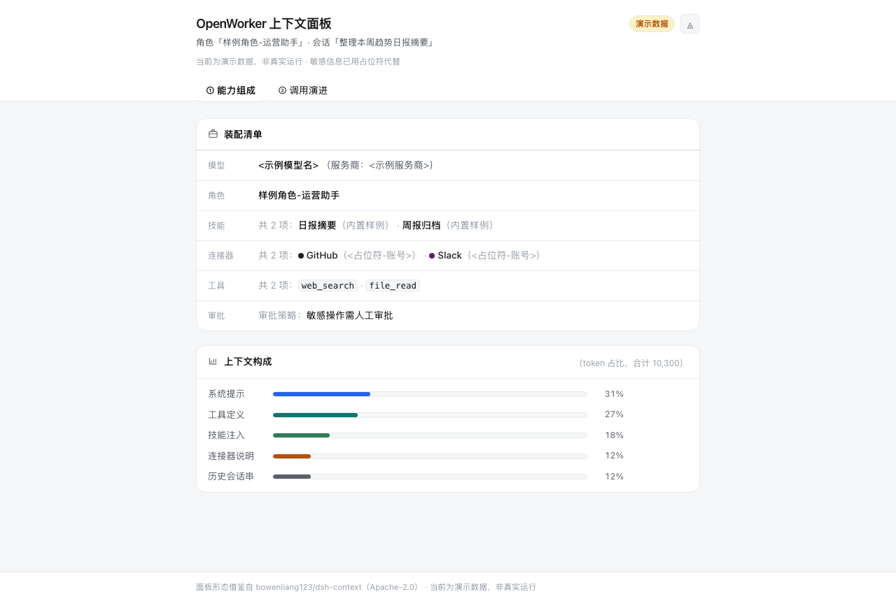
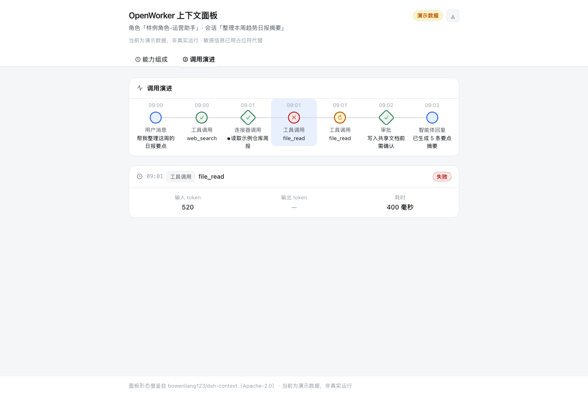

# 中文上下文面板使用指南（PRD-155/T4，trend #778）

> 对应 PRD-155（dsh-context 式中文上下文可视化面板）。借鉴 bowenliang123/dsh-context（Apache-2.0）面板形态，代码自研零依赖；文案表见 T1（PR #42），面板实现见 T2/T3（PR #43/#44）。

## 面板是什么

给中文用户的双页签只读面板，看懂 agent 的一次会话里**能力怎么装配、调用怎么演进**：

- **页签① 能力组成**：装配清单（连接器/技能/工具）+ 上下文 token 构成五段（系统提示/工具定义/技能注入/历史轮次/材料引用）占比条。
- **页签② 调用演进**：时间线按发生顺序列出每次调用（● 消息/工具/回复、◆ 连接器/审批），节点颜色标注状态（✓ 成功 / ✕ 失败 / ↻ 已重试）；点击节点看详情（输入/输出 token、耗时、GitHub 品牌徽标）。

## 开箱步骤（10 分钟内）

1. **打开面板**：仓库根目录双击 `ui-mocks/dsh-context-panel.html`（零依赖、无需安装、仅本机浏览器打开；`file://` 下自动回退页内同源演示数据副本）。
2. **切换主题**：右上角切换亮/暗主题（`data-theme`）。
3. **看组成**：默认落在页签①，读占比条与合计 token（标注「本地聚合」口径）。
4. **看演进**：点页签②，点击任一节点看详情卡（默认已选中首节点，详情即时可见；键盘 ←/→ 可在两页签间切换）。*(T5 勘误：原「◀ ▶ 步进/自动回放」与 T3 实现不符，实际交互为点击节点——见验收记录。)*
5. **换数据**：面板只认 `panel-data v1` 契约（`ui-mocks/fixtures/panel-demo-data.json`）；demo 适配器先行动，真实 coworker 适配器留桩（对齐三规则：直连/映射/缺字段不造假数）。

*（真实截图：页签① 能力组成，T5 验收补）*

*（真实截图：页签② 调用演进 + 失败节点详情卡，T5 验收补）*

## 红线

- 演示数据全虚构（角色「运营助手」为占位样例），不含真实主机名/IP/账号/密钥（自查断言钉住）。
- 只读面板：不发网络请求、不写入任何数据源；「压缩记录」区因无真实数据源不做空壳。

## 与其他文档的联动

- T5 验收记录（逐步计时、密钥扫描、勘误）见 [docs/context-panel-acceptance.md](context-panel-acceptance.md)。
- 安装动线见 `install-zh.sh` / README §4~§6（PRD-121，PR #38）。
- 双语 README 的英文同步在 `README.en.md`（PRD-122，PR #39 合并后补面板小节英文版）。
