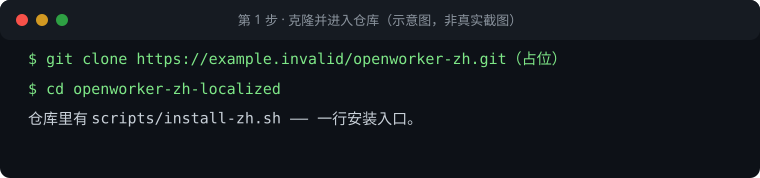
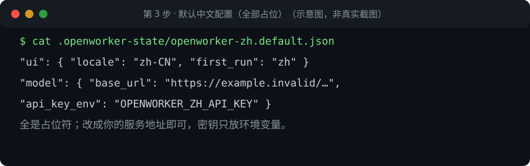
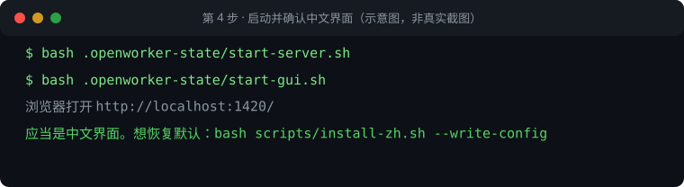
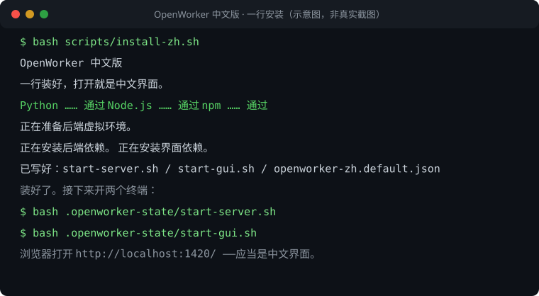

# OpenWorker 中文版 · 带截图的安装指南（装好即用）

> PRD-121/T4（trend issue #607）。每一步配示意图，命令可直接复制。
> 图为演示环境示意图（非真实截图），全部使用占位地址，不含真实主机名、IP、账号或密钥。
> 目标：新用户 10 分钟内装好并跑通第一个任务（验收口径见 T5）。

## 第 1 步：克隆并进入仓库



```bash
git clone <你的仓库地址>   # 占位：按实际仓库填写
cd openworker-zh-localized
```

## 第 2 步：一行安装


```bash
bash scripts/install-zh.sh
```

- 脚本会检查 Python ≥3.10 与 Node.js ≥20：不够就停下，不替你下载工具链。
- 不写系统目录、不需要管理员权限；令牌只留在本机 `.openworker-state/`。
- 依赖已在时想重装：加 `--force`。只想体检：`bash scripts/install-zh.sh --check`。

## 第 3 步：确认默认中文配置



```bash
cat .openworker-state/openworker-zh.default.json
```

- `ui.locale` 默认 `zh-CN`：装完打开就是中文界面。
- `model.base_url` 是占位符（`example.invalid`）：改成你的服务地址。
- 密钥只放环境变量 `OPENWORKER_ZH_API_KEY`，配置文件里永远没有密钥值。
- 想恢复全部默认：`bash scripts/install-zh.sh --write-config`。

## 第 4 步：启动并确认中文界面



开两个终端：

```bash
bash .openworker-state/start-server.sh   # 终端 1：后端
bash .openworker-state/start-gui.sh      # 终端 2：中文界面
```

浏览器打开 <http://localhost:1420/> ——应当是中文界面。白屏先看终端报错。

## 全流程速览



## 常见问题

- **装完白屏**：先看终端 2 的报错；多数是端口被占，用 `OPENWORKER_ZH_PORT=8766` 换端口。
- **想换状态目录**：`OPENWORKER_ZH_STATE_DIR=/path/to/dir`。
- **体检环境**：`bash scripts/install-zh.sh --check`。
- **预演（不写任何文件）**：`bash scripts/install-zh.sh --dry-run`。
