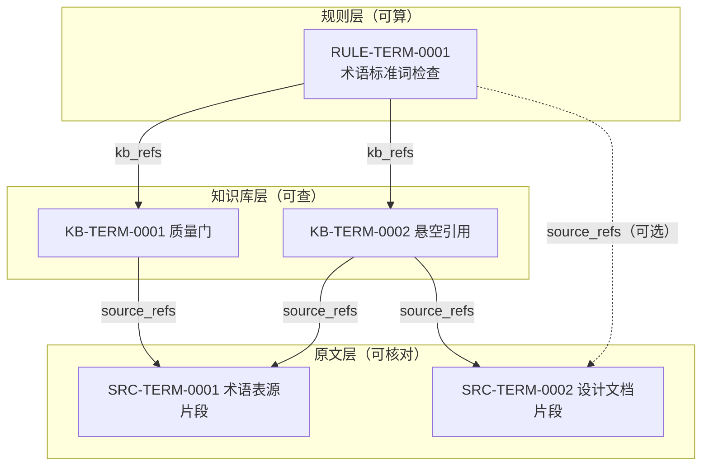

# PRD-240/T1 三层知识结构设计（规则层/知识库层/原文层）

- 任务：PRD-240「中文结构化知识引擎」· T1（结构设计：三层数据模型与引用关系）
- 对应 trend issue：#1200
- 状态：待设计评审
- 范围边界：T1 只冻结数据模型、ID/引用键规范、一致性约束与迁移示例；校验器与执行器在 T4 落地，存量全量迁移另行排期。

## 1. 背景与借鉴声明（红线）

PRD-240 要求中文知识条目做到「可算、可查、可溯源」，因此按三层组织：

- 规则层：可算——给定输入能算出确定结果；
- 知识库层：可查——按词条/分类检索的结构化条目；
- 原文层：可核对——逐字保留的原文依据片段。

**借鉴声明**：本设计的「算法 + 知识库 + 原文数据」三层组织思路，仅借鉴开源仓库 `Renhuai123/ziwei-doushu` 的**分层结构**；其协议未核实，**不复用其任何代码、数据与内容**，该仓库属命理领域，与本引擎**完全无关**。

**内容红线（全程有效）**：本文档及后续所有数据、示例中不得出现任何命理、占卜、星盘类内容或示例；示例一律使用通用中文技术/产品术语，并显式标注「示例」。本文档不含任何真实内部主机名、IP、账号或密钥，涉及处一律使用 `<占位符>`（如 `PLACEHOLDER_ACCOUNT`、`PLACEHOLDER_HOST`）。

## 2. 三层总览

| 层 | 职责 | 存放内容形态 | 交互方式 |
|---|---|---|---|
| 规则层 R | 承载可执行/可推导的计算逻辑，把知识「算」出来 | 结构化规则文件（声明式表达式、判定表、公式、受控脚本）+ 元数据 | 被规则引擎/校验器调用（T4） |
| 知识库层 K | 承载可检索的知识条目，是三层的中枢 | 结构化条目文件（词条、对照、定义、分类、状态） | 被规则层引用；向下游回指原文层 |
| 原文层 S | 承载可核对的原文依据，只进不改 | 逐字引文片段 + 来源与定位元数据 | 只被上层引用，不引用任何层 |

引用方向（自上而下，禁止反向与跨层循环）：

1. 规则 → 知识条目：规则通过 `kb_refs` 引用其语义所依赖的知识条目（必填，非空）。
2. 规则 → 原文（可选）：规则可用 `source_refs` 直接回指定义其语义的原文依据，作为补充，不得替代规则 → 知识 → 原文主链路。
3. 知识条目 → 原文：条目通过 `source_refs`（非空）回指其定义/译名所依据的原文片段。



（图中 id 与词条均为第 7 节的示例数据。）

存储布局（仓库内，纯文本、可 diff、可 review）：

```text
knowledge/
  sources/<domain>/SRC-<domain>-<NNNN>.yaml   # 原文层
  kb/<domain>/KB-<domain>-<NNNN>.yaml         # 知识库层
  rules/<domain>/RULE-<domain>-<NNNN>.yaml    # 规则层
  index/                                      # 生成的反向引用索引（机器产物，禁止手改）
```

`<domain>` 为两位以内小写域码，示例：`term`（术语）、`doc`（文档）、`ui`（界面文案）。

## 3. 原文层数据模型

字段表（文件主体即下表字段，YAML，UTF-8）：

| 字段 | 类型 | 必填 | 约束 / 说明 |
|---|---|---|---|
| `src_id` | string | 是 | 主键，格式 `SRC-<domain大写>-<4位序号>`，全局唯一，永不复用 |
| `source_id` | string | 是 | 来源标识，二选一形态：`gh://<org>/<repo>@<commit-ish>/<path>`（代码仓文件）或 `doc://<标准或文档号>/<版本>`（外部文档）；不得含真实内部主机名/IP，内部源用 `<占位符>` |
| `excerpt` | string | 是 | 原文片段，逐字摘录（不改写、不翻译、不删改标点），单条建议 ≤ 2000 字 |
| `locator` | object | 是 | 定位信息：`chapter`（章节）/`section`（小节）/`clause`（条目号），代码源可加 `line_start`/`line_end` |
| `lang` | string | 是 | 语言标签（BCP-47），如 `zh-CN`、`en` |
| `version` | string | 是 | 来源文档版本（commit 短哈希、标准版本号或文档修订号） |
| `checksum` | string | 是 | `excerpt` 的 SHA-256（十六进制），用于漂移检测 |
| `captured_at` | string | 是 | 录入时间，ISO 8601 UTC，如 `2025-01-15T08:00:00Z` |
| `captured_by` | string | 是 | 录入主体，账号一律占位，如 `PLACEHOLDER_ACCOUNT` |
| `status` | enum | 是 | `verified`（已核对）/ `unverified`（待核对） |
| `notes` | string | 否 | 备注，仅客观说明，不得混入解释性知识 |

不变式：`src_id` 一经合并不改不删；`excerpt` 修改视为新版本，必须更换 `src_id` 或递增版本并重新校验上层引用（见 §6）。

## 4. 知识库层数据模型

| 字段 | 类型 | 必填 | 约束 / 说明 |
|---|---|---|---|
| `entry_id` | string | 是 | 主键，格式 `KB-<domain大写>-<4位序号>`，全局唯一，永不复用 |
| `term_zh` | string | 是 | 中文标准词条（唯一规范形），同一 domain 内唯一 |
| `term_en` | string | 是 | 英文对照（可为空串表示暂无对照，但字段必须存在） |
| `aliases` | string[] | 否 | 别名/曾用名/易混词，检索用；不作为引用键 |
| `definition` | string | 是 | 定义，中文一句话，语义须能被 `source_refs` 支撑 |
| `category` | string | 是 | 所属分类，取值来自受控词表（如 `术语/质量`、`术语/引用`），词表由仓库维护 |
| `source_refs` | string[] | 是 | 回指原文 id 列表，非空，每项须为已存在的 `src_id`（不得悬空） |
| `status` | enum | 是 | `verified`（已核）/ `unverified`（待核）/ `deprecated`（废弃） |
| `entry_version` | integer | 是 | 条目修订号，内容变更即 +1 |
| `updated_at` | string | 是 | 更新时间，ISO 8601 UTC |
| `updated_by` | string | 是 | 更新主体，账号一律占位，如 `PLACEHOLDER_ACCOUNT` |
| `notes` | string | 否 | 备注 |

不变式：`status=verified` ⇔ `source_refs` 中至少一条原文 `status=verified`；条目进入 `deprecated` 前须确认无生效规则引用（见 §6.3）。

## 5. 规则层数据模型

| 字段 | 类型 | 必填 | 约束 / 说明 |
|---|---|---|---|
| `rule_id` | string | 是 | 主键，格式 `RULE-<domain大写>-<4位序号>`，全局唯一，永不复用 |
| `name` | string | 是 | 规则名，中文短语，同一 domain 内唯一 |
| `form` | enum | 是 | 规则表达形态：`expr`（声明式表达式/伪代码，T1 推荐）/ `table`（判定表/映射表）/ `formula`（数学式）/ `script`（受控脚本，需评审解锁） |
| `body` | string | 是 | 规则本体，形态须与 `form` 一致；T1 只冻结形态与语法约定，执行器在 T4 |
| `inputs` | object[] | 是 | 输入参数表：`{name, type, constraint}`，类型须为封闭集合（string/integer/boolean/enum/引用id） |
| `outputs` | object[] | 是 | 输出参数表：`{name, type}`；类型封闭同上 |
| `precondition` | string | 是 | 适用条件；不满足时的行为是输出统一「不适用」结果，而非随机失败 |
| `kb_refs` | string[] | 是 | 引用的知识条目 id 列表，非空，每项须为已存在的 `entry_id` |
| `source_refs` | string[] | 否 | 回指原文依据（规则语义的直接出处），每项须为已存在的 `src_id` |
| `determinism` | string | 是 | 确定性声明，固定取值 `strict`（见 §5.1） |
| `rule_version` | integer | 是 | 规则修订号 |
| `status` | enum | 是 | `draft`（草案）/ `active`（生效）/ `deprecated`（废弃） |
| `updated_at` | string | 是 | 更新时间，ISO 8601 UTC |
| `updated_by` | string | 是 | 更新主体，账号一律占位，如 `PLACEHOLDER_ACCOUNT` |
| `notes` | string | 否 | 备注 |

### 5.1 「可算」的含义界定

一条规则称为**可算**，当且仅当同时满足：

1. **纯函数**：输出仅由声明输入决定；不读取外部状态、系统时间、随机源或网络。
2. **类型封闭**：输入、输出均为本表定义的可序列化封闭类型。
3. **确定性**：相同输入必得相同输出，含错误路径——`precondition` 不满足时输出唯一的 `not_applicable` 结果。
4. **可重放**：`body` 可由 T4 执行器在离线环境重放并得到一致结果。

`form=script` 的规则须额外通过沙箱评审，证明满足上述 1–4 条后方可置为 `active`。

## 6. 引用关系与一致性约束

### 6.1 引用键定义

- 唯一引用键即目标层主键：`src_id`、`entry_id`、`rule_id`。
- 跨层引用只允许「键引用」，禁止按词条文本、行号或 URL 隐式引用（文本可改，键不可改）。
- 序号不复用：删除的 id 永久空缺，防止引用指向语义已变的对象。

### 6.2 引用方向约束

| 引用边 | 是否允许 | 说明 |
|---|---|---|
| 规则 → 知识条目（`kb_refs`） | 必须（非空） | 主链路 |
| 规则 → 原文（`source_refs`） | 可选 | 补充语义出处 |
| 知识条目 → 原文（`source_refs`） | 必须（非空） | 主链路 |
| 原文 → 任何层 | 禁止 | 原文层是叶子 |
| 知识条目 → 规则 | 禁止 | 防循环、保持单向 |
| 同层互引 | 禁止（T1） | 同层关系用分类与索引表达 |

### 6.3 引用完整性要求（不得悬空引用）

- 任何 `source_refs`/`kb_refs` 中的键必须指向**当前存在**的对象；CI 阶段即拒绝悬空引用的 PR。
- 删除约束：原文被 ≥1 知识条目引用时不可删除；知识条目被 ≥1 生效规则引用时不可置 `deprecated`（需先改规则或同步下线）。
- `index/` 中的反向索引（谁引用了我）由工具重建生成，是校验输入而非事实源。

### 6.4 三方一致性校验设计要点（T4 预埋）

T4 实现校验器；T1 冻结以下检测项语义与错误码：

| 检测项 | 错误码 | 检出方式（要点） |
|---|---|---|
| 悬空引用 | `E-DANGLING-REF` | 全量收集三层主键集合，逐条比对引用列表成员资格 |
| 引用方向/循环违规 | `E-ILLEGAL-EDGE` | 按 §6.2 白名单建边表，扫描非法边 |
| 双向计数对账 | `E-COUNT-MISMATCH` | 正向引用数与 `index/` 反向被引数逐键对账 |
| 状态一致性 | `E-STATUS-MISMATCH` | 生效规则 ⇒ 其 `kb_refs` 全部 `verified`；`verified` 条目 ⇒ 至少一条 `verified` 原文 |
| 内容漂移 | `E-CONTENT-DRIFT` | 原文 `checksum` 变化 ⇒ 引用它的条目自动降为 `unverified` 待复核 |
| 规则待复算 | `E-RULE-STALE` | 条目 `entry_version` 变更 ⇒ 引用它的规则标记待重放（T4 重放比对输出） |
| 术语对齐 | `E-TERM-MISMATCH` | 规则 `body` 中出现的术语字面量必须命中其 `kb_refs` 对应条目的 `term_zh`/`aliases` |

「对不齐」的判定原则：**任何一条链路（规则 → 知识 → 原文）断裂、越界或状态倒挂，均判不一致**；校验以错误码 + 涉及键清单输出报告，供质量门阻断。

## 7. 术语表迁移示例（示例数据，通用技术术语）

以下全部为**示例**，演示存量术语（PRD-067 质量门术语表）如何一拆为三。

### 7.1 示例：一条存量术语的拆分

存量术语表一行（示例）：

```text
质量门 | quality gate | 合并前必须通过的一组自动化检查 | 术语/质量
```

拆分结果（三层各一个文件，YAML，示例）：

```yaml
# knowledge/sources/term/SRC-TERM-0001.yaml —— 原文层（示例）
src_id: SRC-TERM-0001
source_id: gh://<org>/<repo>@<commit>/docs/glossary.md
excerpt: "质量门（quality gate）：合并前必须通过的一组自动化检查。"
locator: { chapter: "附录A", section: "A.1", clause: "A.1.3" }
lang: zh-CN
version: "<commit-short-hash>"
checksum: "<sha256-of-excerpt>"
captured_at: "2025-01-15T08:00:00Z"
captured_by: "PLACEHOLDER_ACCOUNT"
status: verified

# knowledge/kb/term/KB-TERM-0001.yaml —— 知识库层（示例）
entry_id: KB-TERM-0001
term_zh: 质量门
term_en: quality gate
aliases: [准入检查]
definition: 合并前必须通过的一组自动化检查。
category: 术语/质量
source_refs: [SRC-TERM-0001]
status: verified
entry_version: 1
updated_at: "2025-01-15T08:05:00Z"
updated_by: "PLACEHOLDER_ACCOUNT"

# knowledge/rules/term/RULE-TERM-0001.yaml —— 规则层（示例）
rule_id: RULE-TERM-0001
name: 术语标准词检查
form: expr
body: "违规 = 文案中命中 alias 且未与 term_zh 同时出现"
inputs:
  - { name: text, type: string, constraint: "非空，≤10000 字" }
  - { name: domain, type: enum, constraint: "term" }
outputs:
  - { name: violations, type: string[] }
precondition: "text 为中文界面文案或文档段落"
kb_refs: [KB-TERM-0001, KB-TERM-0002]
source_refs: [SRC-TERM-0002]
determinism: strict
rule_version: 1
status: active
updated_at: "2025-01-15T08:10:00Z"
updated_by: "PLACEHOLDER_ACCOUNT"
```

### 7.2 示例：另外两条术语的三层落位（摘要）

| 存量词条 | 原文层（示例） | 知识库层（示例） | 规则层（示例） |
|---|---|---|---|
| 悬空引用 | `SRC-TERM-0001`（术语表同片段）+ `SRC-TERM-0002`（设计文档 §6.3 片段） | `KB-TERM-0002`，回指两条原文，`verified` | 被 `RULE-TERM-0001` 引用（文案中禁用非标准词） |
| 冻结期 | `SRC-TERM-0003`：术语表片段「冻结期（freeze window）：发布前禁止合入的时段」 | `KB-TERM-0003`，category `术语/发布`，`unverified`（原文仅一条且待核） | `RULE-DOC-0002`：判定某时间点是否落入冻结期（输入时间区间，输出布尔） |

### 7.3 拆分操作步骤（T1 冻结，供迁移执行）

1. 为术语表当前版本建原文层条目（逐字摘录 + 定位 + 版本），`status` 按人工核对结果标注。
2. 逐行生成知识库层条目，`source_refs` 指向第 1 步原文；无法溯源的行标 `unverified`，不得虚构 `src_id`。
3. 识别可计算语义（如标准词检查、冻结期判定），立规则层条目并挂 `kb_refs`；无计算语义的条目仅存于知识库层。
4. 跑 §6.4 全套检测，清零 `E-*` 错误码后方可宣告该批迁移完成。

## 8. 验收点清单（对应 trend issue #1200）

- [ ] 三层职责、内容形态、引用方向定义明确，附结构表与图（§2）。
- [ ] 原文层字段表完整：id、来源标识、片段、定位、语言、版本、录入时间等（§3）。
- [ ] 知识库层字段表完整：id、中英文词条、定义、分类、回指原文列表、状态、更新时间等（§4）。
- [ ] 规则层字段表完整：id、表达形态、输入、输出、引用条目列表、回指原文、适用条件等（§5）。
- [ ] 「可算」有可操作定义（纯函数、类型封闭、确定性、可重放）（§5.1）。
- [ ] 引用键、引用方向白名单、不得悬空引用等完整性约束成文（§6.1–6.3）。
- [ ] 三方一致性校验检测项与错误码预埋齐全，覆盖 T4 检出需求（§6.4）。
- [ ] 存量术语迁移示例 ≥2 条、全部标注「示例」且可复演（§7）。
- [ ] 红线复核：全文无命理/占卜/星盘内容与示例；无真实主机名/IP/账号/密钥（§1）。
- [ ] 设计评审通过，评审记录归档于 `<评审记录链接占位符>`。

---

*本文档由 pi（GLM-5.3）起草、Muse 验收。*
